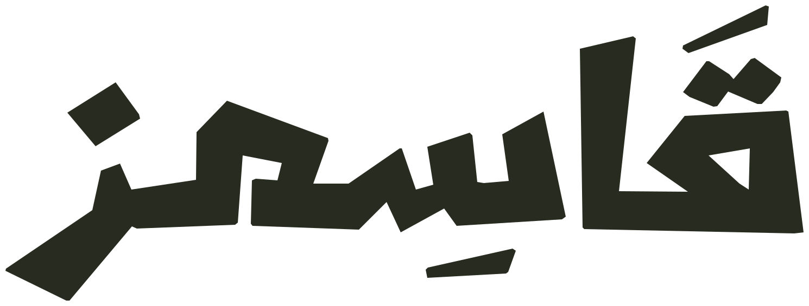

<div align="center">



# AHMED QASSIM — قاسمز

الموقع الرسمي لأحمد قاسم وقناة **قاسمز** على يوتيوب.
مبني بـ **React + Vite** مع **GSAP** و **Lenis** و **WebGL**.

</div>

---

## المحتويات
- [التشغيل](#التشغيل)
- [هيكل المشروع](#هيكل-المشروع)
- [تعديل المحتوى](#تعديل-المحتوى)
- [الهوية: الألوان والخطوط واللوجو](#الهوية-الألوان-والخطوط-واللوجو)
- [الأقسام والحركات](#الأقسام-والحركات)
- [النشر](#النشر)
- [ملاحظات مهمة](#ملاحظات-مهمة)

---

## التشغيل

محتاج **Node.js 20 أو أحدث** ([nodejs.org](https://nodejs.org) — نسخة LTS).

```bash
npm install      # أول مرة بس
npm run dev      # يشغّل الموقع على http://localhost:5173
npm run build    # يطلّع نسخة النشر في فولدر dist
npm run preview  # يجرّب نسخة النشر محلياً
```

من **VS Code**: `File → Open Folder` ← افتح فولدر المشروع ← `Terminal → New Terminal` ← الأوامر اللي فوق.

---

## هيكل المشروع

```
├── index.html                  # العنوان، الوصف، الخطوط، preload للصور
├── public/
│   ├── images/
│   │   ├── hero-1.webp         # صورة الدخول (مقصوصة بدون خلفية)
│   │   ├── hero-2.webp         # بالنظارة والكاب (بتنكشف مع الماوس)
│   │   └── topo-*.svg          # خلفية الخطوط الكنتورية (فاتح/داكن)
│   ├── fonts/                  # Quiverleaf Arabic CF — 5 أوزان (woff + otf)
│   ├── brand/                  # شعار قاسمز SVG (داكن / ليموني / فاتح)
│   └── favicon.svg
├── assets-src/cutouts/         # الصور المقصوصة بالجودة الكاملة (PNG) — مش بتتنشر
└── src/
    ├── data/
    │   ├── content.js          # ⭐ كل النصوص والروابط والصور
    │   └── logo.js             # الشعار كمسارات SVG (6 قطع للأنيميشن)
    ├── lib/
    │   ├── heroGL.js           # تأثير الكشف السائل (WebGL بدون مكتبات)
    │   └── split.js            # تقسيم النص للأنيميشن (العربي بالكلمة مش بالحرف)
    ├── hooks/useLenis.js       # التمرير الناعم مربوط بـ GSAP
    ├── components/
    │   ├── Preloader.jsx       # شاشة التحميل الليمونية
    │   ├── Nav.jsx             # النافبار + القائمة الكاملة
    │   ├── Hero.jsx            # الهيرو (sticky)
    │   ├── Message.jsx         # الرسالة الكبيرة
    │   ├── Track.jsx           # المعرض الأفقي
    │   ├── OnOff.jsx           # على الهواء / خلف الكواليس
    │   ├── Hall.jsx            # أشهر الحلقات
    │   ├── Lower.jsx           # الفيديوهات، الشركاء، السوشيال، الفوتر
    │   └── Bits.jsx            # اللوجو، الأزرار، تأثير النص المتدحرج
    └── styles/global.css       # كل الستايل + متغيرات الألوان والخطوط
```

---

## تعديل المحتوى

**كل التعديلات اليومية من ملف واحد: `src/data/content.js`**

| عايز تغيّر | فين في `content.js` |
|---|---|
| لينك القناة | `site.youtube` ← حط لينكك مكان `@YOUR_CHANNEL` |
| الإيميل | `site.email` |
| أحدث الفيديوهات | `videos.items` ← حط `id` كل فيديو |
| أرقام القناة | `videos.stats` (مشتركين / مشاهدات / فيديوهات) |
| الرسالة الكبيرة | `message` — الكلمة بين `[[ ]]` بتظهر ليموني |
| النص اللي ورا الصورة | `hero.marqueeTop` و `hero.marqueeBottom` |
| صور المعرض الأفقي | `track.items` |
| روابط السوشيال | `socials` |

### إزاي تجيب الـ id بتاع فيديو
من لينك الفيديو: `https://www.youtube.com/watch?v=`**`dQw4w9WgXcQ`** ← الـ id هو الجزء بعد `v=`.
الصورة المصغّرة بتتجاب أوتوماتيك من يوتيوب، والضغط على الكارت بيشغّل الفيديو جوه الموقع.

### الصور
- صورك ضعها في `public/images/` واكتب المسار في `content.js` كده: `'/images/photo.jpg'`
- الصور المؤقتة حالياً من picsum.photos — استبدلها بصورك.
- **صورتين الهيرو**: لو هتغيّرهم لازم يكونوا **نفس المقاس ونفس الكادر بالظبط** وبخلفية شفافة (PNG/WebP).
  حجم الشخص ومكانه بيتظبط من `fitH` و `top` في `src/components/Hero.jsx`.

---

## الهوية: الألوان والخطوط واللوجو

### الألوان (أول `src/styles/global.css`)
| المتغير | اللون | الاستخدام |
|---|---|---|
| `--lime` | `#d2ff00` | الأزرار، شاشة التحميل، التوقيع |
| `--lime-2` | `#b2c73a` | الكلمات المميزة |
| `--dark` | `#282c20` | الخلفية الأساسية الداكنة |
| `--olive` | `#36392e` | المعرض الأفقي |
| `--paper` | `#f4f4ed` | الأقسام الفاتحة |
| `--ink` | `#dde1d2` | النص على الداكن |
| `--black` | `#111112` | قسم أشهر الحلقات |

### الخطوط
| الخط | الاستخدام |
|---|---|
| **Quiverleaf Arabic CF** (Light → ExtraBold) | كل العربي — العناوين ExtraBold والكلمات المميزة Light |
| **Mona Sans** | الإنجليزي والأرقام |
| **Gloock** | `AHMED` في اللوجو |
| **Aref Ruqaa** | كلمة خط اليد في قسم «على الهواء» بس |

### اللوجو
- `public/brand/qassimz-mark-*.svg` — شعار قاسمز بثلاث ألوان.
- `src/data/logo.js` — نفس الشعار مقسوم 6 قطع (بيتحرك قطعة قطعة في شاشة التحميل والفوتر).
- `NameLockup` في `Bits.jsx` — اللوجو المركّب **AHMED / QASSIM**.

---

## الأقسام والحركات

| القسم | الحركة |
|---|---|
| **شاشة التحميل** | خلفية ليمونية، قطع الشعار بتظهر وتختفي في لوب لحد ما الموقع يحمّل، وبعدين الستارة بتطلع لفوق |
| **النافبار** | لونه بيتغير حسب لون القسم، وبيستخبى مع النزول ويرجع مع الطلوع، والنص بيتدحرج مع الـ hover |
| **القائمة** | خلفية بتنزل من فوق، عمودين صور بيتحركوا لوحدهم، والصورة الخاصة بالرابط بتتلوّن |
| **الهيرو** | WebGL: الماوس بيكشف صورة النظارة والكاب بحافة سائلة وبقع رمادي على الخلفية، وفيه حركة تلقائية لما الماوس يقف أو على الموبايل. مع التمرير الصورة بتصغر لكارت ويظهر وراها نص متحرك وتوقيع ليموني بيترسم |
| **الرسالة** | الكلمات بتنوّر واحدة واحدة مع التمرير |
| **المعرض الأفقي** | التمرير العمودي بيحرّك الصور بالعرض، والصورة بتتلوّن لما توصل لنص الشاشة |
| **على الهواء / خلف الكواليس** | كلمة بخط اليد بتظهر مع الـ hover، والصورة الجانبية بتدخل |
| **أحدث الفيديوهات** | عدّادات + كروت بتتفرد زي المروحة + تشغيل الفيديو جوه الموقع |
| **أشهر الحلقات** | كروت بإطار مقصوص، والصورة بتتبدّل مع الـ hover، والأعمدة بسرعات مختلفة |
| **الشركاء** | شريط شعارات بيسرع ويميل حسب سرعة التمرير |
| **السوشيال** | كروت بتتفرد زي المروحة |
| **الفوتر** | بيظهر من تحت المحتوى، والشعار بيتجمع قطعة قطعة |

كل الحركات بتتلغي لو الجهاز مفعّل فيه «تقليل الحركة» (`prefers-reduced-motion`).

---

## النشر

### Cloudflare Pages (مقترح)
1. Cloudflare ← Workers & Pages ← Create ← Pages ← Connect to Git ← اختار الريبو
2. Framework preset: **Vite** — Build command: `npm run build` — Output: `dist`
3. Save and Deploy — وبعدين اربط الدومين من Custom domains

### GitHub Pages (متظبط ✅)
أي push على `main` بيبني الموقع وينشره أوتوماتيك عن طريق `.github/workflows/deploy.yml`.
الرابط: **https://ahmedqassimtv-commits.github.io/qasasimv2/**
تقدر تتابع النشر من تبويب **Actions** في الريبو.

> مسار النشر بيتظبط لوحده من اسم الريبو. لو هتضيف صور جديدة في الكود استخدم `asset('images/x.jpg')` من `content.js` بدل `/images/x.jpg` عشان تشتغل على GitHub Pages.

### دومين خاص
Settings ← Pages ← Custom domain. ساعتها غيّر `BASE_PATH` في الـ workflow لـ `/`.

---

## ملاحظات مهمة
- **الخط مدفوع:** Quiverleaf Arabic CF — اتأكد إن رخصتك بتسمح باستخدامه كـ webfont، وخلي الريبو **Private**.
- **الصور المؤقتة** (picsum) محتاجة إنترنت وهتتغير — استبدلها بصورك قبل النشر.
- **لينك القناة** لازم يتغير من `@YOUR_CHANNEL` قبل النشر.
- `assets-src/` فيه الصور الأصلية المقصوصة بجودة كاملة، ومش بتدخل في الموقع المنشور.
